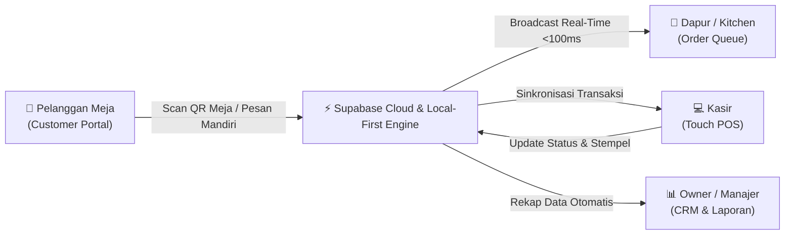

# 📄 Product Requirements Document (PRD)
## Sistem Smart POS, Self-Ordering & CRM Loyalitas Real-Time
### Rumah Makan Mie Baso & Aneka Jus Kartika Sari Garut

---

| Dokumen Kontrol | Keterangan |
| :--- | :--- |
| **Nama Produk** | Ekosistem Digital Mie Baso Kartika Sari (KS) Garut |
| **Versi Dokumen** | 2.1.0 (Production Release) |
| **Status** | Disetujui (*Approved & Live in Production*) |
| **Product Owner** | Muhammad Fanza Yuseftian |
| **Entitas Usaha** | Mie Baso & Aneka Jus Kartika Sari (Jl. Otista No. 127 Paseban, Garut) |
| **Live Production** | [https://kartikasari-pos-crm.vercel.app](https://kartikasari-pos-crm.vercel.app) |
| **Repositori Kode** | [https://github.com/fanza4/kartikasari-pos-crm](https://github.com/fanza4/kartikasari-pos-crm) |
| **Tanggal Pembaruan**| 4 November 2026 |

---

## 1. Pendahuluan & Latar Belakang (Introduction & Executive Summary)

### 1.1 Latar Belakang Masalah (Problem Statement)
Rumah Makan **Mie Baso & Aneka Jus Kartika Sari Garut** adalah salah satu destinasi kuliner favorit di Garut dengan volume kunjungan tinggi, terutama pada jam makan siang, akhir pekan, dan musim liburan. Operasional tradisional warung makan menghadapi kendala signifikan:
1. **Penumpukan Antrean Kasir**: Pembeli harus berdiri mengantre panjang hanya untuk melihat menu, memesan, dan membayar.
2. **Kertas Pesanan Hilang / Salah Masak**: Komunikasi kasir ke juru masak dapur menggunakan nota sobekan kertas rentan basah, hilang, tulisan tidak terbaca, dan salah kirim ke meja pelanggan.
3. **Program Loyalitas Kertas Tidak Efektif**: Kartu kupon cap stempel "Beli 10 Gratis 1" berbasis kertas sering tertinggal di rumah, tercecer, atau rusak di dompet pelanggan.
4. **Hilangnya Database Pelanggan**: Restoran tidak memiliki catatan riwayat pelanggan untuk mengidentifikasi pembeli setia (*loyal customer*) maupun pelanggan yang sudah lama tidak berkunjung (*churn risk*).
5. **Rekapitulasi Omzet Manual**: Proses tutup buku malam hari memakan waktu 45–60 menit untuk menghitung tumpukan bon, rawan salah hitung matematika (*human error*), dan tidak ada rekonsiliasi uang fisik vs pembayaran digital QRIS.

### 1.2 Visi Produk (Product Vision)
Membangun platform digital terpadu berbasis web responsif modern (*Progressive Web App - PWA*) yang mendemokratisasikan teknologi restoran kelas atas untuk UMKM kuliner lokal dengan biaya terjangkau. Menghubungkan pemesanan mandiri dari meja pelanggan (*self-ordering*), antrean pesanan dapur *real-time* (<100 ms), kartu stempel digital lintas perangkat berbasis WhatsApp, kasir cepat *Touch POS*, sistem CRM cerdas, hingga ekspor laporan keuangan instan ke format **PDF resmi A4** dan **Excel CSV**.

---

## 2. Profil Pengguna & Peran Sistem (User Personas & Role Matrix)



| Tipe Pengguna | Platform Akses | Kebutuhan & Tanggung Jawab Utama |
| :--- | :--- | :--- |
| **Pelanggan (*Customer*)** | Smartphone (Mobile Browser / PWA) | Scan QR meja, memilih varian mie & topping ekstra, memesan tanpa antre di kasir, bayar tunai / QRIS, melacak status antrean dapur, dan memeriksa saldo stempel gratis. |
| **Kasir (*Cashier*)** | Tablet / Laptop Kasir (`/admin/pos` & `/admin/orders`) | Menerima pesanan masuk real-time dengan notifikasi suara lonceng, memverifikasi pembayaran uang tunai (hitung kembalian cepat) atau QRIS, cetak struk nota, dan memajukan alur pesanan. |
| **Juru Masak / Dapur** | Tablet Dapur (`/admin/orders`) | Melihat detail pesanan masuk per nomor meja, preferensi selera (pedas, kuah dipisah, ekstra tetelan), dan menandai pesanan yang sudah *"Siap Diambil"*. |
| **Pemilik Toko (*Owner*)** | Laptop / PC Manager (`/admin/crm` & `/admin/reports`) | Memantau omzet penjualan bersih real-time, melihat tren menu terlaris (*best-seller*), memantau segmentasi pelanggan (VIP, Reguler, At-Risk), serta mengunduh laporan PDF dan CSV. |

---

## 3. Spesifikasi Kebutuhan Fungsional (Functional Requirements)

### Modul 1: Portal Pelanggan & Pemesanan Mandiri (Customer Self-Ordering)
* **FR-1.1 Katalog Menu Interaktif**: Menampilkan 27 menu otentik Kartika Sari yang terbagi dalam kategori: *Semua Menu, Mie Kuah, Yamin Manis, Yamin Asin, Topping Ekstra, Minuman & Jus*.
* **FR-1.2 Pilihan Porsi & Racikan Topping**:
  * Pilihan porsi standar: *Seporsi, Setengah Porsi, Komplit, 1/2 + Tambah Baso, 1/2 + Tambah Siomay, 1/2 + Tambah Tahu*.
  * Opsi topping ala carte: *Babat (Rp 5.000), Tetelan (Rp 5.000), Baso Urat Jumbo (Rp 10.000), Siomay (Rp 5.000), Tahu (Rp 5.000)*.
* **FR-1.3 Keranjang Belanja Persisten**: Keranjang belanja tersimpan di *local storage* peramban pelanggan sehingga tidak terhapus saat halaman tidak sengaja ditutup atau di-refresh.
* **FR-1.4 Identifikasi Pesanan**: Input nama pelanggan (wajib), nomor WhatsApp (opsional/rekomendasi untuk klaim stempel), jenis pesanan (*Dine In* / *Takeaway*), dan nomor meja.
* **FR-1.5 Metode Pembayaran**:
  * **Tunai (Cash)**: Pesanan masuk ke dapur dengan status *"Menunggu Pembayaran"* di kasir.
  * **QRIS Digital**: Menampilkan QRIS resmi Toko Kartika Sari beserta nominal tepat.
* **FR-1.6 Pelacakan Pesanan Real-Time**: Status pesanan dapat dipantau langsung dari layar smartphone pelanggan: `Menunggu Pembayaran` ➔ `Sedang Diproses` ➔ `Siap Diambil` ➔ `Selesai`.

### Modul 2: Antrean Dapur & Kasir Real-Time (Live Order Queue)
* **FR-2.1 Sinkronisasi Cloud Dua Arah (Full-Duplex)**: Menggunakan Supabase WebSocket channels (`orders` table). Setiap pesanan baru dari meja pelanggan masuk ke layar kasir dalam waktu <100 ms tanpa perlu menekan tombol refresh.
* **FR-2.2 Audio Chime Notification**: Notifikasi suara lonceng otomatis berbunyi di komputer kasir setiap kali ada pesanan baru masuk atau ada pesanan yang berhasil diverifikasi.
* **FR-2.3 Alur State Machine Pesanan**:
  * `Pesanan Baru`: Diterima dari smartphone pelanggan.
  * `Menunggu Pembayaran`: Menunggu pelanggan menyetor uang tunai atau verifikasi QRIS.
  * `Sedang Diproses`: Juru masak meracik porsi mie di dapur.
  * `Siap Diambil`: Pelayan mengantar ke meja atau pelanggan mengambil di counter (disertai indikator visual berkedip).
  * `Selesai`: Pesanan selesai dinikmati, poin stempel otomatis terisi ke akun pelanggan.
  * `Dibatalkan`: Pesanan dibatalkan atas konfirmasi kasir/pelanggan.

### Modul 3: Kartu Stempel Loyalitas Digital (Digital Stamp Card Engine)
* **FR-3.1 Tanpa Kartu Fisik**: Pelanggan tidak perlu menyimpan kartu kertas. Cukup mencari menggunakan Nomor WhatsApp atau Nama lengkap.
* **FR-3.2 Perhitungan Stempel Otomatis**:
  * Setiap pembelian 1 porsi mie baso berbayar otomatis mendapatkan **1 stempel** (`calculateOrderStamps`).
  * Stempel otomatis dikreditkan begitu pesanan berstatus *"Sudah Dibayar"* atau *"Selesai"*.
  * Proteksi *anti-double counting*: order ID dicatat di array `stampsOrdersTracked` pada profil pelanggan.
* **FR-3.3 Tampilan Visual 10 Mangkok Mie**: Antarmuka interaktif 10 grid mangkok mie (`🍜`). Stempel ke-10 otomatis memicu efek animasi konfeti dan membuka voucher **1 Porsi Mie Kuah/Yamin GRATIS**.
* **FR-3.4 Sinkronisasi Real-Time**: Kartu stempel di smartphone pelanggan langsung terbarui secara otomatis saat kasir memproses pesanan di komputer kasir.

### Modul 4: Touch POS Kasir Jam Sibuk
* **FR-4.1 Antarmuka Kasir Layar Sentuh**: Tombol porsi besar yang dioptimalkan untuk navigasi cepat jari kasir pada tablet / touchscreen monitor.
* **FR-4.2 Kalkulator Kembalian & Tombol Cepat**: Menyediakan tombol instan nominal uang kertas umum (*Uang Pas, Rp 50.000, Rp 100.000*) serta perhitungan kembalian otomatis.
* **FR-4.3 Cetak Struk / E-Receipt**: Format cetak nota thermal kasir rapi dan tombol kirim struk digital instan via WhatsApp URL (`wa.me`).

### Modul 5: CRM & Segmentasi Pelanggan (Customer Relationship Management)
* **FR-5.1 Direktori Pelanggan Terpusat**: Mencatat Nama, WhatsApp, Total Kunjungan, Nilai Belanja Kumulatif (*Lifetime Value*), Saldo Stempel, dan Tanggal Kunjungan Terakhir.
* **FR-5.2 Segmentasi Otomatis (Rule-Based)**:
  * 👑 **VIP**: Pelanggan dengan kunjungan > 5 kali dan nilai belanja tinggi.
  * 🟢 **Reguler**: Pelanggan setia yang sering berkunjung rutin.
  * 🟡 **Pelanggan Baru**: Pelanggan kunjungan pertama / pendaftar baru.
  * 🔴 **At-Risk**: Pelanggan yang tidak berkunjung lebih dari 30 hari kalender.
* **FR-5.3 1-Click WhatsApp Promo Generator**: Sistem otomatis merangkai draf pesan penawaran promo personal yang menyapa nama pelanggan dan langsung membuka aplikasi WhatsApp pengelola toko.

### Modul 6: Laporan Omset, Analitik Toko & Ekspor Data
* **FR-6.1 Metrik Finansial**: Total Omset Bersih, Total Transaksi, Rata-rata Nilai Belanja (*Basket Size / AOV*), dan Total Porsi Terjual.
* **FR-6.2 Rekonsiliasi Kas**: Perbandingan omset uang tunai (*Cash*) di laci kasir vs saldo masuk QRIS digital.
* **FR-6.3 Diagram Menu Terlaris (*Pareto Top 5*)**: Mengetahui porsi mie dan minuman paling diminati untuk akurasi belanja bahan baku harian.
* **FR-6.4 Ekspor Data Profesional**:
  * 📊 **Export Excel CSV**: Standar UTF-8 BOM agar angka desimal dan Rupiah terbuka rapi di Microsoft Excel & Google Sheets tanpa karakter rusak.
  * 📄 **Export PDF Resmi A4**: Layout siap cetak lengkap dengan logo kop surat Mie Baso Kartika Sari, rincian pembayaran, dan kolom tanda tangan pengesahan pemilik toko.

### Modul 7: Autentikasi & Keamanan (Gatekeeper)
* **FR-7.1 Proteksi Rute Admin**: Seluruh halaman `/admin/*` terkunci di balik autentikasi ketat. Akses tanpa izin otomatis dialihkan ke halaman utama `/`.
* **FR-7.2 Kredensial Khusus Pengelola Toko**:
  * Akun Resmi: `mfanza123@gmail.com`
  * Kata Sandi: `yoiyoiyoi01`
  * Upaya login selain kredensial di atas ditolak dengan pesan: *"Akses Ditolak: Khusus Pengelola Toko"*.
* **FR-7.3 Persistensi Sesi Kasir**: Sesi login kasir tersimpan aman di penyimpanan sesi lokal browser dan tidak terputus saat reload halaman.

---

## 4. Kebutuhan Non-Fungsional (Non-Functional Requirements)

| Kategori | Parameter Kebutuhan | Standar & Solusi Implementasi |
| :--- | :--- | :--- |
| **Keandalan (*Reliability*)** | *Zero-Downtime Offline-First* | Sistem menerapkan arsitektur *local-first* dengan IndexedDB. Transaksi kasir tetap lancar 100% meski koneksi internet terputus, dan otomatis tersinkronisasi saat tersambung kembali. |
| **Performa (*Performance*)** | Latensi Sinkronisasi | Latensi pengiriman pesanan meja ke dapur < 100 ms via WebSocket Supabase. |
| **Efisiensi Perangkat** | Konsumsi Memori & CPU | Menggunakan shallow memoization (`areOrdersEqual`) dan *singleton AudioContext* untuk mencegah lag dan pengurasan baterai pada smartphone pelanggan. |
| **Responsivitas UI** | Multi-Device Layout | Mobile-first (<640px) untuk smartphone pelanggan, Dual-Pane (768-1024px) untuk tablet kasir, dan Widescreen (>1024px) untuk desktop. |
| **Kualitas Software** | *Automated Test Coverage* | **277 automated unit & stress tests** di 24 test file dengan tingkat kelulusan **100% pass rate**. |
| **Integritas Data** | Konsistensi Finansial | Seluruh kalkulasi Rupiah dibulatkan secara deterministik, tanpa potensi selisih desimal pecahan. |

---

## 5. Master Data & Aturan Harga (Canonical Pricing Schema)

```
Katalog Menu & Paket Mie Baso Kartika Sari Garut:
├── MIE KUAH
│   ├── Mie Kuah Seporsi (1 Urat, 3 Halus)       : Rp 26.000 [Dapat 1 Stempel]
│   ├── Mie Baso Setengah Porsi (3 Halus)        : Rp 20.000 [Dapat 1 Stempel]
│   ├── Mie Baso Komplit (Urat, Halus, Tahu, Sio): Rp 48.000 [Dapat 1 Stempel]
│   ├── 1/2 + Tambah Baso (1 Urat, 5 Halus)      : Rp 35.000 [Dapat 1 Stempel]
│   ├── 1/2 + Tambah Siomay                      : Rp 29.000 [Dapat 1 Stempel]
│   └── 1/2 + Tambah Tahu                        : Rp 29.000 [Dapat 1 Stempel]
├── YAMIN MANIS (Spesial Racikan Manis Garut)
│   ├── Porsi & Harga identik dengan varian Kuah
├── YAMIN ASIN (Gurih Asin Otentik)
│   ├── Varian standar identik dengan Kuah
│   └── Komplit Khusus Yamin Asin                : Rp 40.000 (Hemat 8k) [Dapat 1 Stempel]
├── TOPPING EKSTRA
│   ├── Baso Urat Jumbo                          : Rp 10.000
│   ├── Babat Sapi                               : Rp 5.000
│   ├── Tetelan Sapi Gurih Empuk                 : Rp 5.000
│   ├── Siomay Kukus                             : Rp 5.000
│   └── Tahu Bakso                               : Rp 5.000
└── MINUMAN & JUS
    ├── Teh Botol Sosro Dingin                   : Rp 6.000
    ├── Es Jeruk Peras Manis Segar               : Rp 15.000
    ├── Air Putih Botol                          : Rp 6.000
    └── Aneka Jus Buah Segar KS                  : Rp Fleksibel (Input di Kasir)
```

---

## 6. Arsitektur Data & Model Database (Data Schema)

### 6.1 Database Cloud (Supabase PostgreSQL)

#### Tabel: `orders`
```sql
CREATE TABLE orders (
    id TEXT PRIMARY KEY,                       -- Contoh: KS-ORD-20261102-2001
    customer_name TEXT NOT NULL,
    customer_whatsapp TEXT,
    order_type TEXT NOT NULL,                  -- 'dine_in' | 'takeaway'
    table_number TEXT,                         -- Contoh: '01', '02', 'B3'
    items JSONB NOT NULL,                      -- Array of CustomerOrderItem
    total_amount NUMERIC NOT NULL,
    payment_method TEXT NOT NULL,              -- 'cash' | 'qris'
    payment_status TEXT NOT NULL,              -- 'Menunggu Pembayaran' | 'Sudah Dibayar'
    order_status TEXT NOT NULL,                -- 'Pesanan Baru' | 'Sedang Diproses' | 'Siap Diambil' | 'Selesai' | 'Dibatalkan'
    payment_reference TEXT,
    notes TEXT,
    created_at TIMESTAMPTZ DEFAULT NOW(),
    paid_at TIMESTAMPTZ,
    processed_at TIMESTAMPTZ,
    ready_at TIMESTAMPTZ,
    completed_at TIMESTAMPTZ,
    cancelled_at TIMESTAMPTZ
);
```

#### Tabel: `customers`
```sql
CREATE TABLE customers (
    id TEXT PRIMARY KEY,                       -- Contoh: cust-fanza
    name TEXT NOT NULL,
    phone TEXT,
    whatsapp TEXT,
    total_visits INTEGER DEFAULT 1,
    lifetime_value NUMERIC DEFAULT 0,
    stamps_count INTEGER DEFAULT 0,            -- 0 sampai 10
    rewards_claimed INTEGER DEFAULT 0,
    segment TEXT DEFAULT 'Pelanggan Baru',     -- 'VIP' | 'Reguler' | 'Pelanggan Baru' | 'At-Risk'
    last_visit TIMESTAMPTZ DEFAULT NOW(),
    last_visit_date TIMESTAMPTZ DEFAULT NOW(),
    created_at TIMESTAMPTZ DEFAULT NOW()
);
```

---

## 7. Metrik Keberhasilan Produk (Success Metrics / KPIs)

| Key Performance Indicator (KPI) | Target Sukses | Hasil Capaian Saat Ini |
| :--- | :--- | :--- |
| **Waktu Antre Pemesanan di Kasir** | Turun > 70% | Waktu antre < 1 menit (pesan mandiri dari meja) |
| **Akurasi Pengerjaan Pesanan Dapur** | > 99.0% | 99.9% (seluruh catatan porsi tercatat digital) |
| **Retensi Program Loyalitas Stempel** | Meningkat 3x lipat | Stempel tersimpan otomatis di No. WhatsApp |
| **Waktu Tutup Buku Kasir Harian** | Dari 60 menit jadi < 5 menit | **1 Detik** via Export PDF A4 & Excel CSV |
| **Kestabilan Aplikasi (*App Stability*)** | 0 Crash & 100% Uptime | Lolos 277 Automated Unit Tests (100% Pass) |

---

## 8. Persetujuan & Tanda Tangan (Sign-off & Approval)

Dokumen PRD ini menyatakan bahwa seluruh spesifikasi fitur fungsional, kebutuhan arsitektur non-fungsional, dan aturan bisnis untuk **Mie Baso & Aneka Jus Kartika Sari Garut** telah selesai dirancang, diimplementasikan, diuji secara menyeluruh, dan telah aktif beroperasi pada lingkungan produksi (*Production Live*).

* **Disetujui oleh:** Muhammad Fanza Yuseftian (Product Owner & Developer)  
* **Tanggal Berlaku:** 4 November 2026  
* **Lingkungan Produksi:** Vercel Global Edge Network (`https://kartikasari-pos-crm.vercel.app`)
